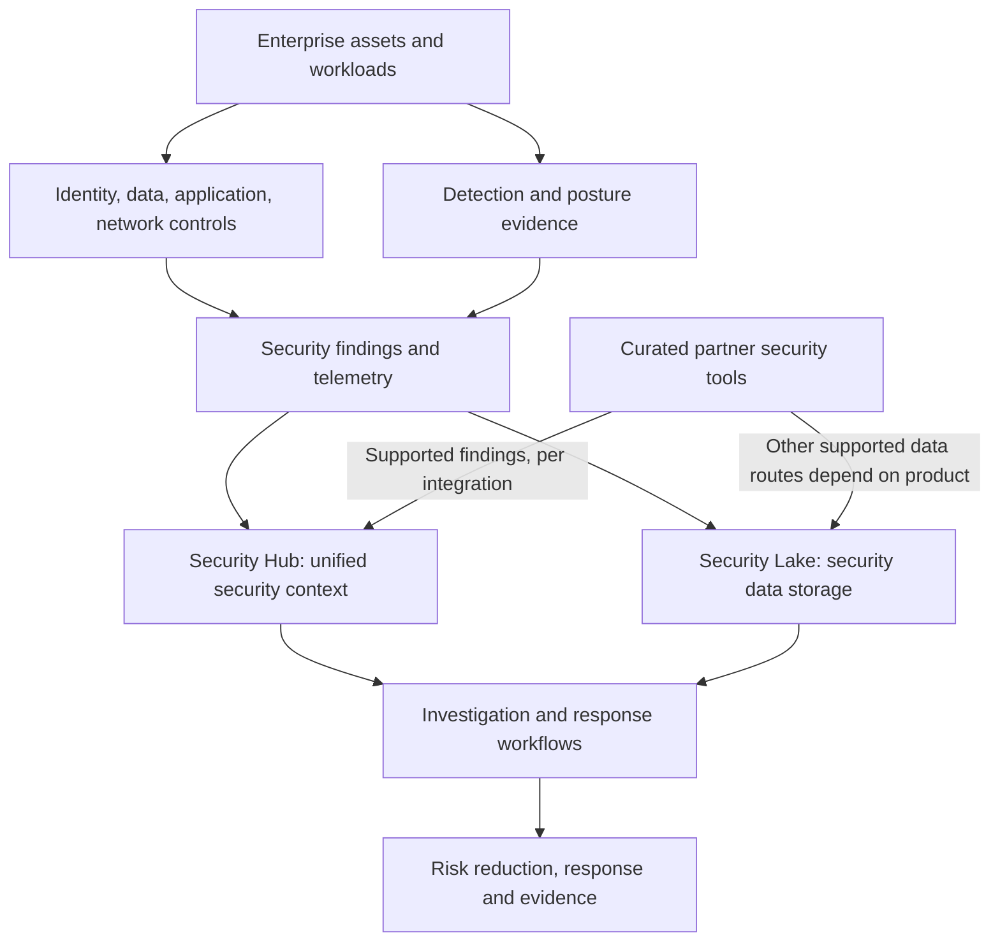

# AWS security ecosystem: buyer-led architecture and partner map

**Status:** research candidate, not published typed claims | **Observed:** 2026-11-16 | **Next review target:** 2026-12-16 | **Owner/reviewer:** pending human editorial assignment

## Purpose and boundaries

Map AWS security as an **ecosystem**, not a flat list of tools: workloads and business processes → attack surface/buyer job → AWS-native controls → centralized findings/data → response and operations → complementary partner solutions → commercial/procurement path. This is general public research, not customer-specific architecture, an internal AWS playbook, an interview transcript, a vendor score, or proof that all AWS/partner products integrate with one another. All official AWS descriptions are **AWS-published claims**, not independent comparative testing. No private account, interview, employee, or pricing information belongs here.

**Existing reuse:** The [security market map](../../README.md) has a vendor/category catalog under `lib/data`, `/landscape`, `/compare`, buyer personas, category pages, and evidence boundaries. Reuse existing AWS/secrets-management records and IDs; do not create a second vendor or source registry. This document is **unpromoted research** until manual review and tests. See the [competitive intelligence playbook](competitive-intelligence-playbook.md) and [progressive exploration guidance](../product/progressive-exploration.md).

## Where AWS Security Hub fits in the market map

**Buyer question.** A team has an external alert, a failed configuration check and a vulnerability on a cloud workload. Which findings concern the same resource, who can fix it, and what evidence will show the exposure changed?

The map places **AWS Security Hub** under cloud-native application protection for its cloud risk prioritization workflow. **AWS Security Hub CSPM** sits under cloud posture management for its configuration checks. Both use the existing Amazon Web Services vendor record. Continuous threat exposure management (CTEM) is the broader program that can use both outputs. Gartner’s public roadmap frames that program at category level. The product descriptions and limitations here come from AWS. [Gartner CTEM abstract](https://www.gartner.com/en/documents/6884566) · [AWS service distinction](https://docs.aws.amazon.com/securityhub/latest/userguide/what-are-securityhub-services.html)

| What the buyer needs | Where the evidence comes from | What to verify |
| --- | --- | --- |
| Identify a failed control | Security Hub CSPM checks configurations against enabled controls and standards. Security Hub can flag accounts missing a qualifying standard. | Record the account, Region, control, resource and evaluation time. A quiet account may have a coverage gap. [CSPM checks](https://docs.aws.amazon.com/securityhub/latest/userguide/what-is-securityhub.html) · [Coverage findings](https://docs.aws.amazon.com/securityhub/latest/userguide/coverage-findings.html) |
| Prioritize cloud risk | Security Hub correlates supported signals. Inspector contributes vulnerability evidence, GuardDuty contributes threat detections, and Macie contributes sensitive-data context. | Open the contributing signals for the same resource. Record why the combination changes the team's priority. AWS requires sufficient signals for an exposure finding. [Exposure findings](https://docs.aws.amazon.com/securityhub/latest/userguide/exposure-findings.html) |
| Assign the fix and verify the outcome | Security Hub can route findings to configured Jira Cloud or ServiceNow integrations. Cloud engineers and application owners control the resource. | Trace one finding to a named owner, a change record and a later control result or external observation. [Ticketing integrations](https://docs.aws.amazon.com/securityhub/latest/userguide/securityhub-v2-integrations.html) |
| Investigate what actually happened | Retained CloudTrail data events can describe object reads when configured. Security Lake can collect supported telemetry for downstream analysis. | Check event coverage for the resource and time window before drawing conclusions about data access. [CloudTrail data events](https://docs.aws.amazon.com/awscloudtrail/latest/userguide/logging-data-events-with-cloudtrail.html) · [Security Lake sources](https://docs.aws.amazon.com/security-lake/latest/userguide/internal-sources.html) |
| Evaluate a mixed AWS and Azure estate | AWS documents a prioritized view of supported Azure resources through a configured connector. The connector requires Security Hub and CSPM in the same AWS account and Region. | Inventory the connected Azure subscriptions, resource types and permissions. Agree on one representative finding in each cloud. [Azure support announcement](https://aws.amazon.com/about-aws/whats-new/2026/06/aws-security-hub-supports-monitoring-microsoft-azure/) · [Connector prerequisites](https://docs.aws.amazon.com/securityhub/latest/userguide/securityhub-v2-azure-prereqs.html) |
| Understand what procurement is buying | Essentials is billed by monitored resource units. Optional add-ons and Extended partner subscriptions have separate charges. | Size the in-scope resources and add-ons, check existing entitlements and validate the partner’s onboarding and data flow. [AWS pricing](https://aws.amazon.com/security-hub/pricing/) · [Extended plan](https://docs.aws.amazon.com/securityhub/latest/userguide/securityhub-extended-plan.html) |

For the operational handoff, [compare the seven SecOps buying decisions](secops-pipelines-detection-enrichment.md#secops-and-its-neighboring-markets), from incoming telemetry to a provider acting after hours.

### Six buyer conversations

The six scenarios are illustrative. The application entry point is `/categories/cnapp#aws-security-hub`. Each scenario includes the team that owns the decision, a discovery question, a proposed proof of closure and its original sources.

| Trigger | First sales question | Examples and evidence |
| --- | --- | --- |
| An unfamiliar public hostname points to production. | Can the exposure team match its outside observation to an owned cloud resource and see whether other findings change its priority? | Microsoft Defender EASM for outside discovery and AWS Security Hub for cloud context. [Microsoft](https://learn.microsoft.com/en-us/azure/external-attack-surface-management/overview) · [AWS](https://docs.aws.amazon.com/securityhub/latest/userguide/exposure-findings.html) |
| An AWS access key appears in public code. | Who can identify the IAM user, retire the key and confirm the application still works? | GitGuardian Public Monitoring or Truffle Security Forager supplies an observation within its covered sources. IAM owns key state. The workflow does not assume a direct integration with Security Hub. [GitGuardian](https://docs.gitguardian.com/public-monitoring/sources/overview) · [Truffle Security](https://trufflesecurity.com/docs/user-enablement-guide) · [AWS IAM](https://docs.aws.amazon.com/IAM/latest/UserGuide/access-keys-admin-managed.html) |
| An exposed employee credential may belong to a cloud administrator. | Can the SOC trace that identity to a cloud role and account for sessions already issued? | SpyCloud supplies the external observation. Workforce IAM and cloud IAM investigate sign-ins and sessions. [SpyCloud](https://docs.spycloud.com/public-sc/docs/workforce-threat-protection) · [Microsoft Entra ID Protection](https://learn.microsoft.com/en-us/entra/id-protection/howto-identity-protection-investigate-risk) · [AWS role sessions](https://docs.aws.amazon.com/IAM/latest/UserGuide/id_roles_use_revoke-sessions.html) |
| A new account reports no failed controls. | What proves the relevant standard evaluated this resource in this Region? | Cloud governance reconciles expected coverage and checks the actual control result with the account owner. [AWS coverage findings](https://docs.aws.amazon.com/securityhub/latest/userguide/coverage-findings.html) |
| GuardDuty detects unusual reads from a sensitive S3 bucket. | Which objects can the investigator show were read, and who can confirm whether that was expected? | GuardDuty, Security Hub and retained object events serve different steps in the existing [Cedar Ridge learning scenario](aws-security-learning-scenario-2026-11.md). [GuardDuty](https://docs.aws.amazon.com/guardduty/latest/ug/guardduty_finding-types-s3.html) · [CloudTrail](https://docs.aws.amazon.com/awscloudtrail/latest/userguide/logging-data-events-with-cloudtrail.html) |
| An acquisition adds Azure subscriptions. | In a representative account from each cloud, can we explain a finding and route it to the correct owner? | Compare connected coverage, exceptions, response ownership and incremental cost with the buyer’s existing cloud platform. [AWS connector scope](https://aws.amazon.com/about-aws/whats-new/2026/06/aws-security-hub-supports-monitoring-microsoft-azure/) · [AWS pricing](https://aws.amazon.com/security-hub/pricing/) |

For a pilot, agree on one external signal and one enrolled workload. Measure elapsed time from observation to an identified owner, then from assignment to a verified change at the resource. Keep missing telemetry, unconfirmed ownership and unsupported integrations explicit. These are proposed measures for the customer to baseline.

**Review record.** Original product documentation and commercial pages inspected November 20, 2026. Product behavior is publisher-reported. The map’s placements, discovery questions and success measures are editorial. Retain the original publisher’s rights and link to the cited sections. Owner for review is the Security Market Map maintainer. Recheck by December 16, 2026 or when service scope, pricing or supported integrations change.

## 1. Zoom-out: what is being protected?

| Customer asset / workload | Why security matters | Relevant underlying AWS services (examples, not complete coverage) | Decision owner / supporting buyer |
| --- | --- | --- | --- |
| Cloud accounts and identities | Privilege, persistence, cross-account trust | Organizations, IAM, IAM Identity Center, STS, Control Tower | CISO, cloud platform, IAM |
| Compute / containers | Runtime compromise, exposure, patching | EC2, Lambda, ECS, EKS, Fargate, ECR | Cloud security, platform, DevSecOps |
| Object / database data | Sensitive-data discovery, encryption, exfiltration | S3, RDS/Aurora, DynamoDB, KMS | Data security, privacy, CISO |
| Internet-facing applications and networks | Exploitation, DDoS, lateral movement | VPC, CloudFront, Route 53, API Gateway, ALB | Network security, AppSec, platform |
| Dev lifecycle and automation | Vulnerable software, exposed credentials, pipeline trust | CodeBuild, CodePipeline, ECR, IAM roles | AppSec, engineering, supply chain |
| Analytics and security telemetry | Cross-account visibility and investigation | CloudTrail, CloudWatch, S3, EventBridge, Athena, OpenSearch | SOC, security engineering |
| AI and agentic applications | Data access, authorization, prompt/tool abuse, workload identity | Bedrock, IAM, KMS, S3, API Gateway, CloudTrail | AI platform, AppSec, data security |

*Important:* Underlying AWS services are workloads or supporting infrastructure, **not automatically security products**. Their security configuration creates opportunities for native controls and complementary third-party tools. Examine the shared-responsibility model and actual architecture before recommending anything.

## 2. AWS-native security capabilities by buyer job

| Buyer problem | AWS-native services to understand | How to explain the job (not a guarantee of full coverage) | Discovery question |
| --- | --- | --- | --- |
| Identity, workforce and application authorization | IAM, IAM Identity Center, Cognito, Verified Permissions, Organizations, STS | Grant and govern identities, access, and fine-grained application authorization | Which identities and cross-account privileges create your highest risk? |
| Keys, certificates and secrets | KMS, Secrets Manager, CloudHSM, Certificate Manager, Private CA | Encrypt data, manage keys and certificates, store/rotate application secrets | Where do machine credentials live, and who owns rotations and access? |
| Threat detection | GuardDuty, Detective, Security Hub | Detect suspicious activity, investigate, and bring security signals together | What is your path from an AWS alert to a confirmed incident? |
| Vulnerability and posture | Inspector, Security Hub CSPM, Config, Control Tower | Find exposure/vulnerabilities and configuration or control gaps | Who owns remediation and how do you prioritize risk across accounts? |
| Sensitive-data protection | Macie, KMS, S3 controls | Discover sensitive S3 data and protect data access/encryption | Can you identify sensitive cloud data and who can access it? |
| Network and edge protection | WAF, Shield, Network Firewall, Firewall Manager, VPC controls, Route 53 Resolver DNS Firewall | Protect web apps, network boundaries and policy management | Which externally exposed applications and traffic paths matter most? |
| Governance and evidence | Audit Manager, Artifact, Config, Organizations, Control Tower | Collect evidence and manage security guardrails across accounts | How much effort does audit evidence collection consume? |
| Security telemetry and response | Security Lake, Security Hub, EventBridge, Systems Manager, Security Incident Response | Centralize and route security data and orchestrate investigations or remediation | Which data is duplicated across your SOC tools, and what slows response? |
| AI workload protection | Bedrock capabilities + IAM, KMS, CloudTrail, data/network controls; partner AI security where appropriate | Secure the identities, tools, data paths, and runtime of AI applications | How are agent tool permissions and access to sensitive data controlled? |

**Products that must not be collapsed:** `AWS Security Hub` (broader unified security experience), `AWS Security Hub CSPM` (posture and best-practice checks), `Amazon Security Lake` (security data lake), and an actual SIEM/SOAR/MDR tool solve different jobs. Investigate exact product-plan and integration boundaries before adding comparison claims.

## 3. The ecosystem as a flow

This is a **conceptual flow**, not an assertion that every AWS service publishes every event to Security Hub or that all partner tools integrate with Security Lake. AWS-native, partner, and customer-built paths require individual validation.

## 4. AWS Security Hub Extended: curated partner ecosystem

AWS announced the **Extended** plan in February 2026 to simplify selection/procurement/integration of curated security vendors; its May update covered 21 solutions in nine categories. On **August 4, 2026**, AWS announced **23 curated partners across 10 categories**, with supply-chain security added (Chainguard and Socket). The list below is the **August snapshot**. These are **AWS-curated partners**, not evidence of exclusivity or comparative superiority, and not a statement that all capabilities are the same across vendors.

| Category (AWS's label) | What buyers are solving | Relevant AWS-curated partner examples from August list | Research caution |
| --- | --- | --- | --- |
| Endpoint | Compromise and response across endpoints | CrowdStrike, SentinelOne | Confirm sensor, licensing, response and edition |
| Identity | Workforce, privileged and machine access governance | Okta, CyberArk, SailPoint, Britive | IAM and IGA/PAM/NHI aren't interchangeable |
| Email | Phishing, account compromise, email protection | Proofpoint, Sublime | Do not infer pre-delivery versus post-delivery behavior |
| Network | Enterprise access and protection | Zscaler, Palo Alto Networks | Different layers of network and SSE controls |
| Data | Discover/secure sensitive data | Cyera, Varonis | DSPM/DLP/permissions scope differs |
| Browser | Browser workspace controls | Island, LayerX | Policy and endpoint dependencies need review |
| Cloud | Cloud runtime, workload and posture risk | Upwind, Oligo, Native Security | CNAPP/CWPP/application instrumentation can overlap only partially |
| AI | AI application/agent risk | Noma, Zenity | Claims about supported runtime/agents need exact technical evidence |
| Security operations | SOC investigations, observability and workflows | Splunk, 7AI, Opti | SIEM/data platform and agent investigation are different jobs |
| Supply chain | Prevent malicious dependencies entering pipelines | Chainguard, Socket | Source/package trust differs from secrets detection |

**Completeness check:** This table groups the 23 vendor names listed by AWS as of August 4, 2026: 7AI, Britive, Chainguard, CrowdStrike, Cyera, Island, LayerX, Native Security, Noma, Okta, Oligo, Opti, Palo Alto Networks, Proofpoint, SailPoint, SentinelOne, Socket, Splunk, Sublime, Upwind, Varonis, Zenity, Zscaler. Category placement above is a **research organizing aid**, not a verified exhaustive AWS vendor-to-category entitlement map. Verify each vendor's official current AWS category and supported integration before promoting into typed product data.

**Commercial model AWS reports:** With Extended, qualifying curated partner solutions may be purchased through a consolidated AWS bill with published pay-as-you-go prices, AWS seller-of-record model, and support/procurement terms described in AWS materials. Do **not** infer commission credit, existing EDP treatment for each customer, universal free support, negotiated discounts, margins, or any customer savings without the applicable commercial terms. Extended is different from general AWS Marketplace or the whole AWS Partner Network.

### Source-linked partner evidence

- [AWS: Extended plan general availability, 2026-02-26](https://aws.amazon.com/about-aws/whats-new/2026/02/sec-hub-extended/) — AWS announcement; AWS-published.
- [AWS: Extended expands to 21 partners / nine categories, 2026-05-20](https://aws.amazon.com/about-aws/whats-new/2026/05/aws-security-hub-extended/) — dated AWS announcement; AWS-published.
- [AWS: supply-chain 10th category / 23 partners, 2026-08-04](https://aws.amazon.com/about-aws/whats-new/2026/08/aws-security-hub-extended-adds-supply-chain-security/) — dated AWS announcement; AWS-published.
- [AWS Security Blog: complete 23-partner snapshot, 2026-08-04](https://aws.amazon.com/blogs/security/security-hub-extended-adds-supply-chain-security-as-its-tenth-category/) — confirms partner name list; AWS-published.

## 5. Example security sales plays (hypotheses, not win claims)

| Buyer trigger | Discovery and business outcome | Native layer | Partner / alternative layer | Evidence to collect for value case |
| --- | --- | --- | --- | --- |
| SOC flooded with fragmented alerts | Reduce time to triage and remediate; identify duplicate workflows | Security Hub, GuardDuty, Security Lake, EventBridge, Security Incident Response | SIEM, investigation agents, MDR, SOAR | Alert volume, analyst-hours, MTTR, data ingestion and tool costs |
| Regulated data migration to AWS | Minimize exposed data, audit burden and misconfiguration | IAM, Macie, KMS, Config, Audit Manager | DSPM, DLP, identity governance | Data classes, compliance controls, remediation time, retention |
| Cloud threat and posture consolidation | Standardize risk management across many AWS accounts | Security Hub CSPM, GuardDuty, Inspector, Organizations | CNAPP, cloud runtime specialists | Existing tools, overlap, risk prioritization, migration effort |
| Greenfield Bedrock agents | Secure permissions, tools, secret delivery and sensitive data | Bedrock plus IAM, KMS, Secrets Manager, CloudTrail | AI security, NHI, DSPM, app security | Agent inventory, scopes, policy gaps, abuse testing |
| Software supply-chain incident | Reduce malicious package introduction and leaked credential risk | IAM, CodeBuild, ECR, Secrets Manager, Inspector where relevant | Chainguard, Socket, secrets scanners | Package inventory, build gate coverage, secret response times |
| App / web edge attacks | Reduce exposure and outage risk | WAF, Shield, Network Firewall, Route 53 | Edge/SSE vendors as requirements dictate | Traffic pattern, incident impact, false positives, app owners |

**Responsible sales stance:** Ask what is already deployed; establish shared-responsibility and architecture constraints; clarify the buyer's business outcome and current run rate; decide whether native, partner, existing tool, or a combination meets the requirements. No fabricated ROI, head-to-head feature parity, or assumed displacement.

## 6. Learning pathway (modular and reusable)

1. **AWS foundations:** Organizations, accounts, VPC, compute, S3, CloudTrail, CloudWatch, IAM. Explain the workload context, trust boundaries and shared responsibility.
2. **Native security service jobs:** IAM/Secrets/KMS, GuardDuty/Inspector/Macie, Security Hub versus CSPM, Security Lake, WAF/Shield, compliance.
3. **One coherent example:** A compromised workload identity attempts S3 exfiltration. Trace preventive controls → detection → evidence → investigation → response. Mark any detection assumptions as scenario hypotheses.
4. **Partner collaboration:** For each buyer gap, compare coexistence, substitution, and procurement options without inferring direct competition.
5. **Business case:** Frame two discovery questions and measurable evaluation criteria for SOC efficiency, consolidation, secure AI adoption, and regulated data.
6. **Certification alignment:** AWS Solutions Architect Associate (architecture), Security Specialty (controls and detection), Developer Associate (event-driven automation), later AI developer work (agent identity, permissions, secure integration).

**Suggested synthetic lab (separate owner):** A no-production Security Intelligence API built with synthetic incidents, Python, Lambda, API Gateway, IAM, and CloudWatch. Do not deploy or enable paid resources without explicit approval; this research repo should not operate cloud infrastructure.

## 7. Data-model and UI placement, not implemented

- **Zoom out:** `/landscape` → cloud security, identity, data, SecOps, AI and software supply chain.
- **Zoom in:** buyer scenario → native AWS service + adjacent partner product → existing vendor/product detail and sourced claim → back to category.
- **Reuse first:** `lib/data/market.ts` existing AWS vendor record; `lib/data/connections.ts`, existing category IDs, `lib/data/sources.ts`, `lib/data/claims.ts` and category/use-case screens. Check current working IDs and open PRs before typed edits.
- **Future concept:** add a filtered AWS ecosystem view as a **lens** on existing landscape, not a new standalone vendor database or navigation system. Distinguish `native-service`, `workload`, `integration`, `curated-partner`, `commercial-route` and `buyer-problem` only if existing schema cannot represent them.
- **Relationship vocabulary:** native control, feeds finding into (sourced), data sent to (sourced), complementary, partial overlap, substitute for defined buyer requirements, procurement via Extended (dated). Unknown by default.
- **Editorial state:** this Markdown is research-candidate material, not new published product claims. Human reviewers must verify names, product plan/edition, category membership, URLs, source licensing, observed dates, and current product docs.
- **Cross-repo consumption:** Builder Academy could author hands-on labs using this source map; GTM Revenue OS could own account exercises and discovery scorecards; interview notes should remain private in the job tracker. Each destination owns its own acceptance criteria. **No automatic cross-repo sync**.

## 8. Acceptance and next review

- [x] Scope pinned to public AWS and vendor/ecosystem sources; no private data.
- [x] Existing map architecture and contributor guidance consulted.
- [x] Buyer problem, native layer, partner layer, boundaries and Unknowns distinguished.
- [x] Dated AWS Extended partner inventory and source links recorded.
- [ ] Confirm every exact vendor-to-category assignment from current AWS documentation before typed catalog import.
- [ ] Inspect overlap with open PR #136 (email vendors) before promotion.
- [ ] Human review of sourced statements and rights/usage.
- [ ] If typed data or UI is added, run repository research integrity tests, unit tests, typecheck, lint, build and browser accessibility checks on the exact PR head.
- [ ] Human approval before merge, deployment, private interview reuse, or downstream cross-repo updates.

## 9. Core source register

| Source | Publisher | Published | Checked | Reliability boundary |
| --- | --- | --- | --- | --- |
| [Security, identity and compliance product catalog](https://aws.amazon.com/products/security/) | AWS | undated/live | 2026-11-16 | AWS-published service grouping; no comparative proof |
| [Security service overview / product distinctions](https://docs.aws.amazon.com/whitepapers/latest/aws-overview/security-services.html) | AWS | undated/live | 2026-11-16 | AWS documentation; feature/plan details need service docs |
| [Choosing AWS security services](https://docs.aws.amazon.com/decision-guides/latest/decision-guides/choosing-aws-security-services.html) | AWS | 2024-12-30 | 2026-11-16 | Historical selection guide; current docs override |
| [AWS Security Hub Extended launches](https://aws.amazon.com/about-aws/whats-new/2026/02/sec-hub-extended/) | AWS | 2026-02-26 | 2026-11-16 | AWS commercial/product announcement |
| [Extended 21 partners](https://aws.amazon.com/about-aws/whats-new/2026/05/aws-security-hub-extended/) | AWS | 2026-05-20 | 2026-11-16 | Historical snapshot superseded by August |
| [Extended 23 partners](https://aws.amazon.com/about-aws/whats-new/2026/08/aws-security-hub-extended-adds-supply-chain-security/) | AWS | 2026-08-04 | 2026-11-16 | Latest inspected dated snapshot, not continuous monitoring |
| [Extended complete partner list](https://aws.amazon.com/blogs/security/security-hub-extended-adds-supply-chain-security-as-its-tenth-category/) | AWS | 2026-08-04 | 2026-11-16 | AWS-reported roster, not independently verified integration parity |
| [AWS Security Specialty service scope](https://docs.aws.amazon.com/aws-certification/latest/security-specialty-03/scs-02-in-scope-services.html) | AWS | undated/live | 2026-11-16 | Exam scope, not a selling or solution architecture requirement |

**Review trigger:** AWS re:Invent launches, changed Extended partner roster/category, Security Hub plan or service renames, updated service capabilities, or materially revised pricing/support/crediting terms. No background monitoring is enabled by this document.
