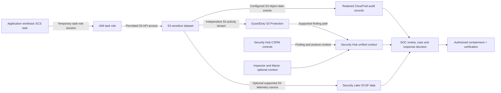

# AWS security learning scenario: compromised workload identity and S3 data access

**Status:** public research / synthetic educational exercise, not a deployed lab or catalog claim  
**Created:** 2026-11-16 | **Review due:** 2026-12-16 | **Editorial owner:** pending  
**Parent:** [AWS Security Ecosystem](aws-security-ecosystem-2026-11.md) | **Companion:** Draft Learn comparison at `/learn?scenario=cedar-ridge&mode=reference#market`

## Learning contract

Explain **why each security service exists**, trace a specific AWS security incident using synthetic data, choose investigation and control measures, compare alternatives fairly, and translate outcomes into an executive value hypothesis. No AWS account, paid service, live calls, access keys, automation, or production changes are required.

**Competencies:** (1) account/identity trust and least privilege, (2) cloud audit sources and detection, (3) Security Hub versus Security Hub CSPM versus Security Lake, (4) response safeguards and shared responsibility, (5) buyer-led competitor and integration discussion, (6) credible business metrics.

### Scenario: Cedar Ridge Health, fictional

A fictional healthcare analytics company runs a customer reporting service on ECS tasks, reading restricted data from an S3 bucket. A task role has overly broad S3 permissions. Simulated telemetry suggests that credentials associated with the role were used for unusually high-volume S3 `GetObject` requests from an unexpected source. The on-call SOC analyst sees a **synthetic** GuardDuty S3 exfiltration finding.

**Scope assumptions:** single AWS account and region for the initial learning case, existing S3 and container workload represented only by paper diagrams; no actual patient data, credentials, logs, or AWS resources. GuardDuty S3 Protection, CloudTrail S3 data events, Security Hub/CSPM, IAM, and Security Lake are **hypothetical enabled services** in the learning scenario, not automatically enabled by default. Synthetic volume is selected for teaching, not an AWS threshold or guaranteed detection.

## Architecture and trust boundaries



GuardDuty S3 Protection does not require customer-configured CloudTrail data event logging. The trail or event data store used by investigators needs separate object-level coverage. See [GuardDuty S3 Protection](https://docs.aws.amazon.com/guardduty/latest/ug/s3-protection.html) and [CloudTrail data events](https://docs.aws.amazon.com/awscloudtrail/latest/userguide/logging-data-events-with-cloudtrail.html).

**Important:** Security Hub is not the same service as Security Hub CSPM. The new Security Hub combines and prioritizes findings and exposures; CSPM focuses on security best-practice checks. Security Lake is a normalized security data store and subscription/query layer, **not** a full SIEM or a substitute for the SOC investigation process. Sources: [AWS distinctions](https://docs.aws.amazon.com/securityhub/latest/userguide/), [Security Lake overview](https://docs.aws.amazon.com/security-lake/latest/userguide/).

## Walkthrough: read → reason → decide

| Phase | What learner sees | What to explain | Decision / expected output |
| --- | --- | --- | --- |
| 1. Establish context | Fictional ECS task and S3 data flow; task role with broad rights | Short-lived role credentials reduce static secret use but don't eliminate misuse of compromised credentials. The policy's resource/action scope sets blast radius. | Identify likely principals, asset owners and minimum legitimate S3 actions |
| 2. Generate signal | Simulated S3 requests at unusual time/location and GuardDuty finding | GuardDuty S3 Protection evaluates CloudTrail S3 data events and may generate `Exfiltration:S3/AnomalousBehavior` for suspicious activity. A finding is a detection assessment, **not confirmation of theft**. | State what is observed versus inferred; list evidence needed |
| 3. Correlate | Synthetic finding plus optional CSPM misconfiguration and Macie sensitive-data context | Security Hub may correlate and prioritize findings. CSPM detects control deviations; Macie adds S3 data sensitivity; Inspector covers vulnerabilities in supported workloads. | Decide which resources and identities warrant first investigation |
| 4. Investigate | Timeline, S3 object identifiers (fictitious), role, region and source IP | CloudTrail provides API event evidence when configured. Security Lake can centralize supported data in OCSF for analysis, not automatically prove intent or data destination. | Write evidence checklist and confidence level; preserve event times |
| 5. Contain safely | Incident owner has authorization and an emergency workflow | Restrict role/session permissions, investigate active sessions, rotate implicated static secrets if any, use least-privilege and change control. Unplanned deny rules could disrupt healthcare reporting. | Propose authorized containment with rollback plan and service owner approval |
| 6. Remediate and learn | IAM permissions reduced; operational logs monitored | Differentiate control failure, telemetry gap, and analyst workflow gap. Review security posture and incident timeline. | Write corrective action, verification evidence, residual risk |
| 7. Commercial analysis | SOC hours, time-to-triage, exposure, tool overlap, workload growth | Value is measured in avoided repeat work, detection/response speed, resilience and secure adoption, not unsupported vendor savings. | Draft two discovery questions, pilot goals, baseline/target metrics |

### Sample synthetic finding (illustrative JSON, not an exact AWS GuardDuty schema)

```json
{
  "exercise_id": "cedar-ridge-s3-001",
  "synthetic": true,
  "finding_type": "Exfiltration:S3/AnomalousBehavior",
  "risk_assessment": "suspicious_s3_data_access",
  "identity": "ecs-task-role-analytics",
  "asset": "example-sensitive-reporting-bucket",
  "activity": {"api": "GetObject", "count_30m": 1800, "usual_count_30m": 45},
  "network": {"source_ip": "198.51.100.27", "note": "RFC 5737 documentation address"},
  "observed_at": "2026-11-16T16:00:00Z",
  "confirmed_exfiltration": false,
  "next_step": "validate_authenticity_and_authorized_access"
}
```

These numbers are synthetic training data. GuardDuty can flag anomalous S3 behavior and compromised-data attack sequences; actual AWS findings have defined AWS formats, scoring, and service-specific fields. Do not use this JSON as an API request or an exact GuardDuty fixture without adapting to the official specification. References: [S3 finding types](https://docs.aws.amazon.com/guardduty/latest/ug/guardduty_finding-types-s3.html), [attack sequences](https://docs.aws.amazon.com/guardduty/latest/ug/guardduty-attack-sequence-finding-types.html).

## Learner prompts with model reasoning criteria

**A. What is the first thing you should conclude?** Only that unusual activity was observed/flagged; confirm principal identity and business legitimacy, data accessed, and event integrity. Avoid declaring a confirmed breach based on synthetic anomalous requests.

**B. Which services matter and why?** IAM sets permissions; GuardDuty assesses suspicious actions; CloudTrail (when configured) contains recorded API events; Security Hub provides prioritization/correlation; CSPM checks posture; Macie supports S3 data sensitivity; Security Lake normalizes/storage/routes supported events; external SIEM may perform broader detection and case operations. Do not conflate them.

**C. How would you prevent a recurrence?** Narrow IAM permissions to required paths/actions, eliminate static secrets, inspect role trust and conditions, scope S3 access, validate logging coverage, and run documented incident exercises. Answer in shared-responsibility terms.

**D. What if customer already owns Wiz and Splunk?** Keep existing tools in scope. Evaluate whether they are system-of-record for risk and SOC workflows; compare AWS-native telemetry, findings delivery, additional context, integrations and incremental cost. Don't automatically position a rip-and-replace.

**E. What should an executive hear?** 'We will validate time to identify the role, relevant data, and affected workload and then measure remediation time and operational effort against your current process.' Use real baseline data before claiming ROI.

## Measurement template for a reusable GTM experiment

| Metric | Baseline collection | Proposed evaluation success condition (example only) |
| --- | --- | --- |
| Time to identify affected identity and owner | Timestamp from synthetic or authorized real workflow | Faster than baseline, with same investigation accuracy |
| Time to validate whether data was accessed | Analyst work log | Evidence-backed determination within agreed SLA |
| Coverage of eligible S3 and cross-account telemetry | Per-account/region enablement and tested log ingestion | All in-scope accounts/regions with verified pipeline |
| Findings routed to existing SOC tooling | Integration test and sampled event count | Expected supported events arrive without loss and duplication |
| False positive / analyst effort | Review log and validated benign cases | Workload and precision acceptable to SOC leadership |
| Corrective controls | Reviewed IAM diffs and approved change records | Permissions constrained with no critical business interruption |
| Commercial impact | Current spend and operations cost from finance + engineering | Economic hypothesis validated, or documented as not proven |

## Certification / further lab handoff (not implemented)

- **SAA:** identify account boundaries, S3 role access, VPC and service architecture.
- **Security Specialty:** least privilege, threat detection, logs, central governance, encryption and response.
- **Developer Associate:** Python event handler, schema validation, idempotency, retry/observability using synthetic fixtures.
- **Generative AI Developer Professional:** Bedrock application threat model, tool permissions, restricted data access and safe agent workflow.
- **Builder Academy future lab:** Implement an **offline-first** Python parser for synthetic findings, run unit tests, then separately propose a Lambda/API Gateway/CloudWatch exercise with explicit approval and costs. Nothing should be provisioned now.

## Editorial and review gates

- [x] Source-backed service purpose and a fully synthetic scenario.
- [x] No private employer, recruiter or interview content, live telemetry or credentials.
- [x] Explicit unknowns: real enablement, actual detection effectiveness, current customer stack, exact commercial terms.
- [ ] Validate the scenario against an official GuardDuty sample fixture if a real API-schema exercise is later requested.
- [ ] Human editorial/source review before promoting any data to `lib/data`.
- [ ] Review the comparison document and overlapping vendor IDs before connecting this case to app UI.
- [ ] No production changes, paid AWS resources, merge or deploy without separate authorization.
