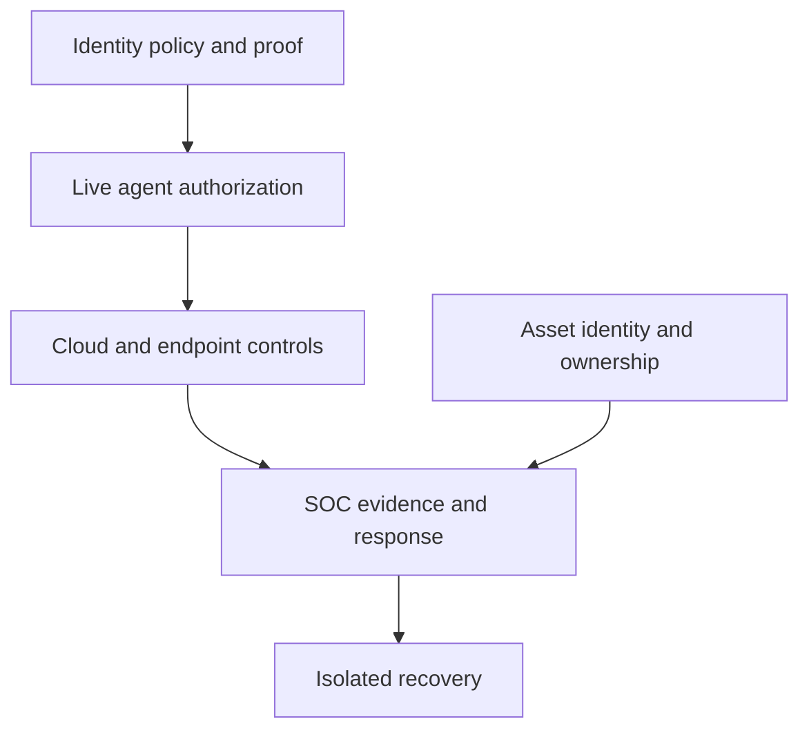

# SACR coverage crosswalk for Security Market Map

**Observed / last checked:** 2026-11-06. **Owner:** Security Market Map maintainer. **Human review:** pending. **Next check:** 2026-12-06. **Status:** proposed editorial mapping, not a deployed taxonomy migration.

Use SACR as a named category and research source. Preserve the map's buyer-led navigation and product evidence standards. This adapts coverage organization; it does not reproduce SACR's rankings, charts or proprietary evaluation methodology.

## Buyer map, November 25, 2026

Start with the decision the buyer needs to make. Examples below illustrate specific workflows or analyst placements. Assess product capability using primary vendor evidence and customer tests.

| Buyer decision | SACR research | Market Map placement | Example or evidence to request |
| --- | --- | --- | --- |
| Can central identity policy reach this app, apply the intended control, and prove the result? | [Identity Policy Enforcement and Governance](https://softwareanalyst.io/reports/identity-policy-enforcement-and-governance) | [Workforce identity](../../context/categories/workforce-identity.md), [IGA](../../context/categories/iga.md), [PAM](../../context/categories/pam.md). Reach, Control, and Proof are evaluation outcomes. | SACR discusses Way Security and Orchid Security. Test a difficult app and verify its effective access after a change. |
| Who can approve a sensitive reset or recovery? | [Social Engineering Identity Defense (SEID)](https://softwareanalyst.io/reports/introducing-social-engineering-identity) | [SEID](../../context/categories/seid.md) | Persona documents identity verification for an Entra ID help-desk reset. Test the fallback approval path as well. |
| What identity and authority should an agent receive? | [Agentic Identity Access Platforms (AIAP)](https://softwareanalyst.io/reports/emerging-agentic-identity-access-platforms-aiap) | [Agent identity](../../context/categories/agent-identity.md) | Request a trace from the sponsoring user to the delegated credential and approved scope. |
| Should this action or access request proceed now? | [Agentic Runtime Identity Security Enforcement (ARISE)](https://softwareanalyst.io/reports/arise-agentic-runtime-identity-security-enforcement-for-agents) and [Intent-Aware Access Fabrics](https://softwareanalyst.io/reports/the-dawn-of-intent-aware-access-fabrics-for-the-ai-era) | [Agentic runtime](../../context/categories/agentic-runtime.md) and [workforce identity](../../context/categories/workforce-identity.md). Access fabric is an architectural lens spanning identity and network controls. | Show the enforcement point, the policy decision, and the audit trail for one tool call or session change. |
| What endpoint actions can security govern across local apps, SaaS, and agents? | [Endpoint Control and Prevention (ECP)](https://softwareanalyst.io/reports/the-ciso-guide-to-endpoint-control-and-prevention-ecp-the-next-architecture-for-endpoint-security) | [Endpoint control](../../context/categories/endpoint-control.md) and [endpoint security](../../context/categories/endpoint-security.md) | Ask for separate evidence of device restrictions, file/process telemetry, and response authority. |
| Can approved cloud boundaries hold as the environment changes? | [Cloud Security Intent Enforcement (CSIE)](https://softwareanalyst.io/reports/the-ciso-s-guide-to-cloud-security-intent-enforcement) | [CSIE](../../context/categories/csie.md) alongside [CNAPP](../../context/categories/cnapp.md) | Act, Aryon, and Native are candidates. Test impact assessment, exceptions, and policy drift. |
| Can responders use live cloud context to decide and act? | [Agentic Cloud Security Platforms (ACSP)](https://softwareanalyst.io/reports/introducing-a-new-cloud-security) | [ACSP](../../context/categories/acsp.md) | Wiz Defend illustrates investigation and response overlap. Check the rest of SACR's criteria separately. |
| Does a finding matter in the running application? | [Runtime Validated Application Security (RVAS)](https://softwareanalyst.io/reports/introducing-runtime-validated-application-security-rvas) | [Runtime-validated AppSec](../../context/categories/runtime-validated-application-security.md) | Trace the finding from source to deployment and record the runtime evidence required to prioritize a fix. |
| Where can sensitive data go, and how do we control that movement? | [Unified Agentic Defense Platforms (UADP)](https://softwareanalyst.io/reports/the-rise-of-uadp-market-share-growth) | [DSPM](../../context/categories/dspm.md), [DLP](../../context/categories/dlp.md), [AI data security](../../context/categories/ai-data-security.md), [NHI](../../context/categories/nhi.md), [ITDR](../../context/categories/itdr.md). UADP is a convergence lens. | Test each control and its owner independently, then verify what context is shared between them. |
| Which asset record can responders trust? | [From CAASM to Asset Intelligence](https://softwareanalyst.io/reports/from-caasm-to-asset-intelligence) | [Asset intelligence](../../context/categories/asset-intelligence.md) beside [cyber asset management](../../context/categories/security-asset-management.md) | SACR profiles Axonius. Show source, freshness, and conflict resolution for one disputed asset. |
| Where are telemetry, search, and detection decisions made? | [Five Emerging SIEM Architectures](https://softwareanalyst.io/reports/the-future-of-siem-part-ii-the-five-emerging-siem-architectures) | [SIEM](../../context/categories/siem.md), [security data pipelines](../../context/categories/security-data-pipelines.md), and [XDR](../../context/categories/xdr.md) | Compare converged SIEM/XDR, observability-connected, pipeline-first, data platform, and federated. SACR places Vega in both data platform and federated. Test retention-tier search and alert coverage. |
| Where should we intervene to reduce people-linked security risk? | [Human Risk Management (HRM)](https://softwareanalyst.io/reports/human-risk-management-in-the-age-of-ai) | [Security awareness](../../context/categories/security-awareness.md) and SEID. Awareness and identity transaction controls address different decisions. | SACR profiles Cimento, a sponsor of the report. Ask how a risk signal leads to a specific intervention and whether exposure falls over time. |
| Can we restore if production admin access is compromised? | [Ephemeral Ransomware Resilience (ERR)](https://softwareanalyst.io/reports/ransomwares-new-kill-switch-ephemeral-ransomware-resilience) | [ERR](../../context/categories/err.md) beside [cyber recovery](../../context/categories/cyber-recovery.md) | Rubrik clean-room identity recovery illustrates one part of the framework. Validate recovery administration isolation, copy frequency, and continuity together. |

**Stairwell's place in the map.** The starting point is [malware analysis](../../context/categories/malware-analysis.md) and [AI SOC investigation](../../context/categories/ai-soc-investigation.md). The [proposed use-case mapping](https://github.com/heyfunwhoa/security-market-map/pull/261) covers SOC alert investigation, retrospective threat hunting, and file-based incident scoping. A SIEM can carry the alert or findings, while Stairwell uses collected files as investigation evidence. [Stairwell's public integrations description](https://stairwell.com/integrations/) documents that handoff.

## Exact broad coverage areas and local mapping

SACR's [current research index](https://softwareanalyst.io/reports) exposes five areas. The existing `sacrLanes` entries in `lib/data/connections.ts` instead use four older groupings and Substack destinations. That is a concrete navigation-refresh candidate, separate from this research submission.

| Current SACR label | Existing local destination | Mapping choice |
| --- | --- | --- |
| Security Operations | `/domains/secops` | Preserve endpoint, detection, SIEM, automation and managed-service drill-downs |
| Data & AI Security | `/domains/data`, `/domains/ai` | One source area spans two local domains; do not collapse the local distinction |
| Identity Security | `/domains/identity` | Keep IAM, PAM, IGA, NHI, ITDR and agent identity separate |
| Cloud & App Security | `/domains/cloud`, `/domains/appsec` | One source area spans cloud runtime and software-development concerns |
| General Cybersecurity | `/landscape` | A research coverage area, not a single product capability |

Publication date of the live index is Unknown. The table is an editorial crosswalk, not a statement that SACR endorses the local hierarchy. Current Security Operations and Identity coverage pages were also inspected:

- https://softwareanalyst.io/reports/coverage/security-operations
- https://softwareanalyst.io/reports/coverage/identity-security

## Security operations: proposed drill-down

These are our practical subgroups using existing category IDs, **not a verbatim SACR hierarchy**.

| Local category IDs | Buyer problem | Important distinction |
| --- | --- | --- |
| `endpoint-security`, `endpoint-control` | Protect workstations and servers; investigate activity; control risky execution | EDR and SACR's ECP framing overlap but are not synonyms |
| `security-data-pipelines`, `siem` | Move, retain and analyze useful evidence at an acceptable cost | A pipeline is not itself a full detection/response program |
| `detection-engineering` | Build, validate, deploy and maintain detection logic | An engine and a maintained detection library are different deliverables |
| `xdr`, `ndr`, `itdr`, `cloud-detection` | Connect threat evidence across environments | Endpoint, network, identity and cloud coverage need separate proof |
| `soar` | Coordinate actions across tools with governance | AI investigation should be assessed by task and operating model, not assumed from SOAR membership |
| `mdr` | Buy operated detection and response | MDR is a service; MSSP is a provider type and may offer MDR |

The [SACR glossary](https://softwareanalyst.io/glossary) provides useful reference terms including EDR, ECP, ITDR, ISPM, NHI, CDR, CNAPP, ASPM and detection engineering. Its emerging terms should remain attributed and should not automatically create new categories or vendor capability cells.

### Endpoint and SOC acronyms in an investigation

Reviewed November 24, 2026. Start with one suspicious installer on a laptop. Each row identifies a decision, a source of evidence, or the team responsible for acting. ECP is SACR’s proposed category. The surrounding terms also circulate across the industry. SACR groups XDR with next-generation SIEM in its glossary; the map keeps their buying questions distinct.

| Term | Meaning | Question in this case |
| --- | --- | --- |
| EPP | Endpoint protection platform | Did a prevention policy block the installer? What verdict was recorded on the laptop? |
| EDR | Endpoint detection and response | If it ran, which processes and connections followed? Can an authorized analyst isolate the host? |
| ECP | Endpoint control and prevention | SACR extends the inquiry into browsers, developer tooling and AI agents. Can policy govern a sensitive action inside the tool? |
| AI-EDR | SACR’s label for visibility into a running AI agent, one part of ECP | If a coding agent invoked a tool, can we trace the action to that agent and see what it accessed? |
| ECPP | Endpoint control and prevention platform | SACR uses this for products spanning multiple ECP zones. Which controls can the buyer actually demonstrate across tools or zones? |
| NDR, ITDR, CDR | Network detection and response, identity threat detection and response, cloud detection and response | Did the device contact an unusual destination, was an account misused, or did a cloud workload perform a suspicious action? Verify each source independently. |
| XDR | Extended detection and response | Can analysts connect endpoint, email, identity or cloud signals into one incident? Which integrations and licenses are required? |
| SDPP | Security data pipeline platform | Which events were normalized, filtered or routed before they reached the analyst? |
| SIEM | Security information and event management | Can the team search historical events across sources and correlate activity around the same host or user? |
| SOAR | Security orchestration, automation and response | Which playbook opens the case or requests containment approval, and where is execution recorded? |
| AISOC | AI-driven security operations center | Which investigation steps can an assistant carry out, what evidence supports its findings, and who authorizes a response? |
| MDR | Managed detection and response | Who monitors overnight, who calls the customer, and who has contractual authority to contain the device? |

**Historical evidence.** A log entry can establish that a tool observed a file. Reanalyzing the original bytes later requires a retained copy. Ask for two demonstrations from the same case: reconstruct the endpoint activity, then show what can still be recovered and examined after the agreed retention window. Stairwell describes historical analysis of files collected from a customer's environment. Its documented collection scope matters when interpreting a search with zero results. [Stairwell product overview](https://docs.stairwell.com/docs/what-is-stairwell)

**Source scope.** The [SACR ECP report](https://softwareanalyst.io/reports/the-ciso-guide-to-endpoint-control-and-prevention-ecp-the-next-architecture-for-endpoint-security) defines ECP and uses the AI-EDR and ECPP labels. The [SACR glossary](https://softwareanalyst.io/glossary/) supplies the EDR, CDR, ITDR, XDR, SDPP, SIEM, SOAR, AISOC and MDR vocabulary. [Cisco’s NDR overview](https://www.cisco.com/site/us/en/learn/topics/security/what-is-network-detection-response.html) describes the network evidence source. [CrowdStrike’s EPP and EDR explainer](https://www.crowdstrike.com/en-us/cybersecurity-101/endpoint-security/epp-vs-edr/) and [Microsoft’s Defender service description](https://learn.microsoft.com/en-us/office365/servicedescriptions/microsoft-365-service-descriptions/microsoft-365-tenantlevel-services-licensing-guidance/microsoft-defender-service-description) illustrate the overlap in actual suite packaging. The questions are editorial prompts. Vendor material describes the publisher’s offering. Source pages were inspected November 24, 2026. Recheck on a terminology or packaging change.

## Identity expansion without category inflation

| Concept | Question to teach | Evidence rule for any vendor profile |
| --- | --- | --- |
| ITDR | Can we detect and respond to identity misuse? | Entity pivots and log ingestion alone are insufficient evidence |
| ISPM | Are identity configurations and permissions risky? | Keep separate from live attack detection |
| NHI | Who owns machine accounts, credentials and their lifecycle? | Not established merely by observing API tokens in logs |
| Agent runtime identity controls | Is this agent action authorized now? | Attribute SACR's ARISE framing; do not imply a shipped capability for any vendor |

These explanations are original paraphrases. They do not equate the presence of an identity integration with a complete identity-security product.

## How to make the map useful to a buyer

Keep four independent lenses:

1. **Security domain/category:** what problem the technology addresses.
2. **Operating model:** build a service, operate a platform, co-manage, or outsource.
3. **Commercial model:** unit/usage basis, commitments, included service and variability.
4. **Evidence state:** vendor claim, analyst framing, tested result, disagreement or Unknown.

At product depth, show detection-content ownership, response responsibility, tenancy, programmability, portability, AI costs and contract gaps. Keep multiple category memberships where supported. A provider can be a buyer, channel partner and competitor in different scenarios.

The [companion research](secops-mssp-economics-2026-11-06.md) applies this structure to Todyl, Stellar Cyber, Torq, Conifers, Blumira, Huntress, Sekoia, Microsoft, CrowdStrike and LimaCharlie. Its additional follow-up candidates are not newly verified products.

## Bounded implementation handoff

- Reuse `sacrLanes`, existing domain/category routes and `/compare`; no new top-level navigation or vendor registry.
- In a later reviewed UI/data PR, update the broad coverage labels to the five current labels; preserve both local destinations where one source area spans two domains. Verify source destinations rather than guessing URL slugs.
- Use the existing `/landscape` → domain → category → vendor flow. Provide a way back to the broader domain and preserve buyer context when comparing products.
- Existing source IDs such as `src-sacr-ecp`, `src-sacr-detection-20260317`, `src-sacr-itdr-20240501` and `src-sacr-arise-20260903` should be checked for reuse; do not re-create a source just because its topic has another label.
- Current typed-source/capability changes: none. Current UI changes: none. Human source review and normal CI precede publication; responsive, keyboard and reduced-motion checks are required if UI changes later.
- Public index/glossary dates are Unknown; source observation dates are recorded above. Use links and brief paraphrases only. Do not import analyst rankings as independently tested performance.
