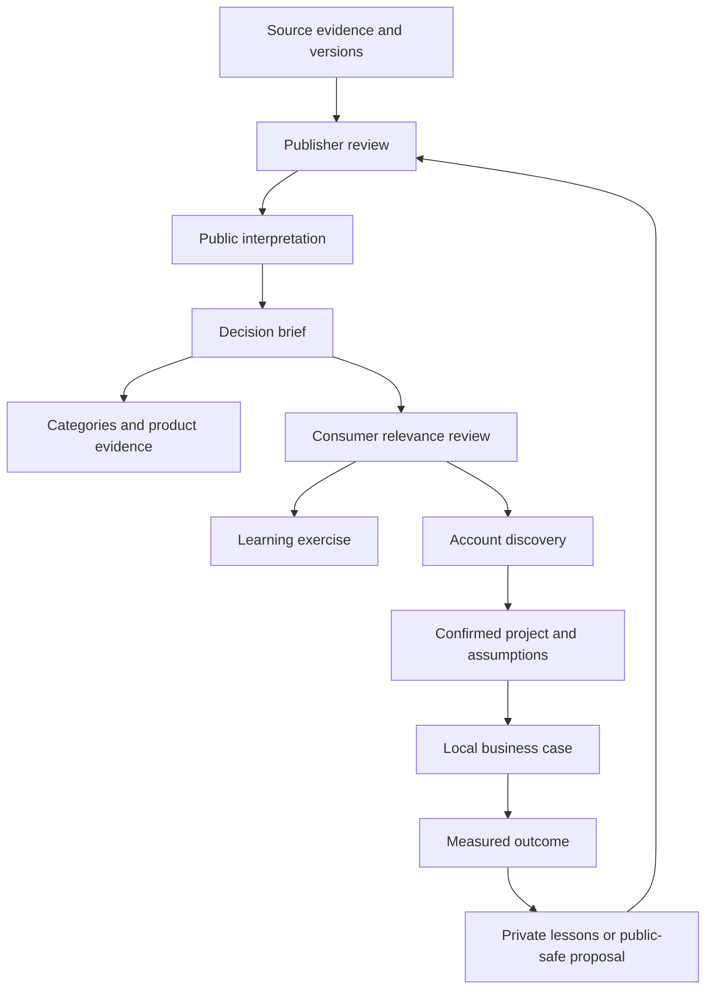

# Executive decision pilot

Status: **editorial pilot, human review pending**. Owner: Security Market Map maintainer. Version: 0.1. As of 2026-11-06; review due 2026-12-04. This is a set of usable documents, not a deployed graph, schema migration or cross-repo integration.

## Start here

| Decision | Business outcome | Capability needed | Pilot brief |
| --- | --- | --- | --- |
| Improve resilience | Restore an essential business service within agreed limits | Recovery, coordination and validated dependencies | [Resilience](resilience.md) |
| Adopt AI safely | Improve one workflow with acceptable quality, cost and risk | Evaluation, controlled access and accountable operation | [Secure AI adoption](secure-ai-adoption.md) |
| Consolidate technology | Reduce avoidable expense while preserving needed service and controls | Portfolio visibility, coverage validation and migration | [Technology consolidation](technology-consolidation.md) |

Use the [blank template](template.md) to create additional briefs. These are vendor-agnostic educational scenarios with no actual customer, approved budget or measured result. They reuse the [budget guide](../../market-research/cio-ciso-budget-agenda.md), [topic tracker](../../market-research/cio-ciso-budget-tracker.csv) and [source notes](../../market-research/cio-ciso-budget-sources.md).

## Connection map

Arrows mean a reviewed relationship or handoff, not automatic copying. A new source version queues review. Outcome feedback remains private unless a separate publication decision clears a generalized public contribution.

The conceptual relationships are many-to-many: one outcome may need several capabilities, one initiative may serve several outcomes, and one category may support several initiatives. Source credibility, applicability and outcome evidence are separate. No transitive inference establishes product suitability, compliance, funding or buying intent.

## Fit with existing structures

| Concept | Use now | Future implementation boundary |
| --- | --- | --- |
| Evidence | Existing bibliography references and original URLs | Reuse approved source/version contracts; no parallel source registry |
| Business outcome | Plain-language objective in each brief | Reconcile with current UseCase expected outcomes before adding an entity |
| Business capability | Vendor-independent ability, described in prose | Distinguish from product-feature capabilities; do not overload capability IDs |
| Initiative | Bounded change with an owner, alternatives and constraints | Review overlap with existing UseCase and BuyingMotion models |
| Decision brief | Markdown connecting the concepts | Document identifier/path is not a production catalog ID |
| Categories/personas | Existing IDs where verified | No new persona/category just for this pilot |
| Vendor/product layer | Evaluate only after requirements | Every product assertion needs its own scoped evidence |
| Account application | Proposed reference and private local assessment | Consumer owner approves; no write from public research into account stores |
| Results | Measurement plan until actual observations exist | Store actuals with method, context and permissions; never backfill hypothetical results |

The [existing knowledge-model proposal](../../architecture/knowledge-model-proposal.md) remains the broader schema design. Related open work inspected: [PR #137](https://github.com/heyfunwhoa/security-market-map/pull/137) for category explanation/audit; [PR #123](https://github.com/heyfunwhoa/security-market-map/pull/123) for buyer personas; [PR #108](https://github.com/heyfunwhoa/security-market-map/pull/108) for use-case discovery. None is assumed merged. Reconcile at implementation rather than duplicate their work.

## Three separate evidence assessments

| Assessment | What earns confidence | Pilot state |
| --- | --- | --- |
| Evidence quality | Original source, clear type/date/method and a claim within its scope | Source types linked; public editorial review pending |
| Applicability | Organization-specific trigger, environment, constraints and corroboration | Unknown: no account evaluated |
| Outcome evidence | Baseline, measured result, measurement method and attribution limits | Unknown: no intervention executed |

Do not average these into one score. A strong source cannot compensate for unknown applicability or absent results. Future consumer records can use supported, partial, unknown or contradicted, with a reason, reviewer and date for each assessment. Those labels are proposed, not a new enforced schema.

## Independent maintenance

Use the [workflow and maintenance design](../executive-priority-workflows.md) for separate publisher/consumer decisions, pinned revisions, freshness windows, permissions and retraction behavior.

- Market Map owns these public briefs and category relationships.
- Research Hub owns its collection/provenance workflow.
- Account research owns local relevance, stakeholder evidence and unanswered questions.
- Revenue planning owns explicitly entered assumptions and calculations.
- Learning owns exercises and progress.

Ordinary revisions may be accepted, deferred or rejected locally. A retraction blocks new evidence-based use and flags affected decisions; it never silently rewrites an account statement or business case. Local annotations remain local. An inaccessible upstream source leaves a visible status/age and follows the agreed freshness limit.

## Pilot walkthrough

1. Choose a brief and read its outcome before looking at categories.
2. Name the missing account facts. Do not fill them with survey averages.
3. Compare the alternatives, including improving the incumbent and deferring.
4. Propose a bounded validation with a baseline and stop conditions.
5. Record an accept/defer/reject decision and its rationale in the owning workspace.
6. Later, compare actual results with the hypothesis. Preserve failed outcomes and confounding changes.
7. Send only approved public-safe lessons back for editorial review.

Example correction drill: a survey source is withdrawn. Flag its contextual citation in the AI brief; do not erase an independently recorded customer requirement. Reassess any recommendation that relied on that survey. If replacement evidence is absent, leave the affected premise unsupported.

## Delivery map

| Step | Owner | Dependency | Done evidence | Current state |
| --- | --- | --- | --- | --- |
| Three briefs and common template | Market Map | Existing research and categories | All sections, citations, alternatives and unknowns present | Authored; editorial approval pending |
| Schema reconciliation | Market Map + shared-contract owner | PR #137 and current model review | One field-authority map; reuse decisions documented | Proposed |
| Consumer exercise | Account Signal Engine owner | Approved brief revision | One public/synthetic case accepted; another rejected for poor relevance | Proposed |
| Integrity exercise | Producer + consumer owners | Accepted reference design | Retraction, replay, unsupported revision and stale-source checks | Proposed |
| Learning reuse | Learning owner | Approved public brief | Exercise explains evidence versus applicability versus results | Proposed |
| Business-case reuse | Revenue OS owner | Confirmed local facts or labeled teaching inputs | Assumptions explicit; no automatic forecast change | Proposed |
| Live connection | Owning app maintainers | Prior gates plus security/readiness review | Auth, rights, failure handling and rollback verified | Deferred |

No downstream tickets, releases or integrations are claimed created by this pilot. Each implementation requires its own owning-repo PR and acceptance evidence.

## Review checklist

- All three briefs use the same template headings.
- Every category ID exists; category relevance is interpretation, not product efficacy.
- Topic IDs resolve to the existing tracker and source IDs to its bibliography.
- Budgets, baselines and results remain Unknown without direct evidence.
- All alternatives, dependencies, adverse outcomes and stop conditions are explicit.
- No private data, vendor ranking, legal compliance conclusion or forecast mutation.
- Review decisions and publication stage remain separate from CI success.
